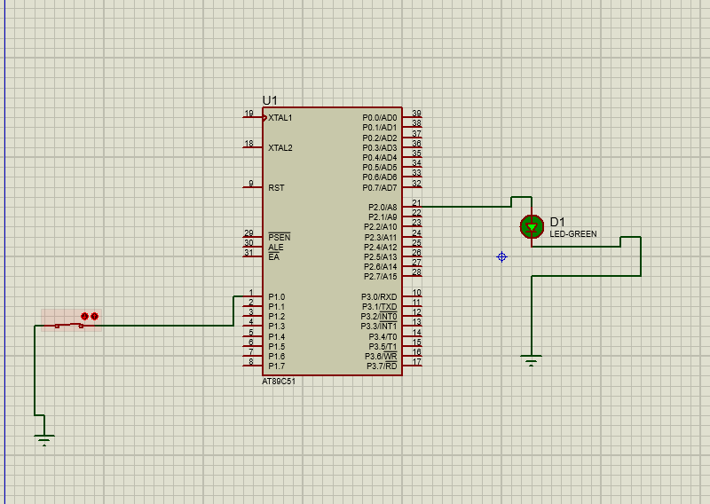

# 🔘 Switch ON/OFF Using 8051 Microcontroller

<p align="center">
  <b>A Basic Embedded Systems Project Using 8051 Microcontroller</b>
</p>

---

## 📌 Project Overview

This project demonstrates the basic operation of switching an output ON and OFF using the 8051 microcontroller.

It focuses on understanding digital input and output operations, switch interfacing, and controlling an output device based on the input received from the switch.

The project provides practical knowledge of microcontroller programming and basic embedded system development.

## 🎯 Objectives

- Understand the fundamentals of the 8051 microcontroller.
- Learn how to interface a switch with the microcontroller.
- Understand digital input and output operations.
- Implement ON/OFF control logic.
- Gain practical experience in embedded system design.

## 🛠️ Tools & Technologies

| Category | Details |
|---|---|
| Microcontroller | 8051 |
| Programming Language | Embedded C |
| IDE | Keil µVision |
| Simulation Software | Proteus Design Suite |

## ⚙️ Working Principle

The switch acts as an input device for the 8051 microcontroller. The microcontroller reads the switch status and performs the corresponding output operation according to the programmed logic.

The process continuously monitors the input and controls the output based on the switch condition.

## 🔄 Working Flow

```text
       START
         |
         ▼
  Initialize 8051
         |
         ▼
  Read Switch Input
         |
         ▼
  Check Switch Status
         |
     ┌───┴───┐
     ▼       ▼
    ON      OFF
     |       |
     ▼       ▼
Output ON  Output OFF
     |       |
     └───┬───┘
         |
         ▼
   Repeat Process
```

## 📸 Circuit Diagram

The following image shows the hardware circuit design of the project.



## 💡 Project Highlights

- Basic 8051 microcontroller interfacing.
- Switch-based input detection.
- Digital output control.
- Practical embedded system implementation.
- Circuit design and simulation using Proteus.

## 📚 Learning Outcomes

- Developed an understanding of 8051 I/O ports.
- Learned the basics of switch interfacing.
- Improved knowledge of Embedded C programming.
- Understood the relationship between hardware inputs and outputs.
- Gained practical exposure to microcontroller-based projects.


---

<p align="center">
  <b>Learning • Building • Exploring Embedded Systems 🚀</b>
</p>
